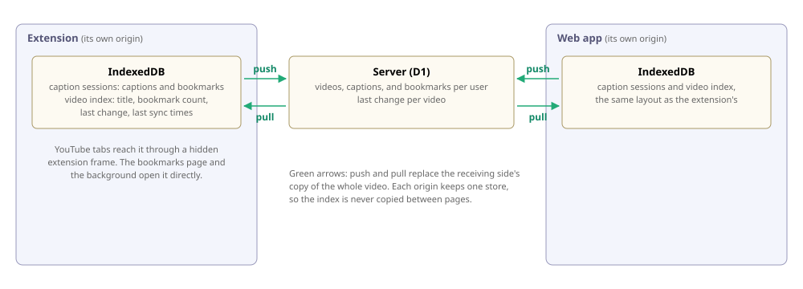
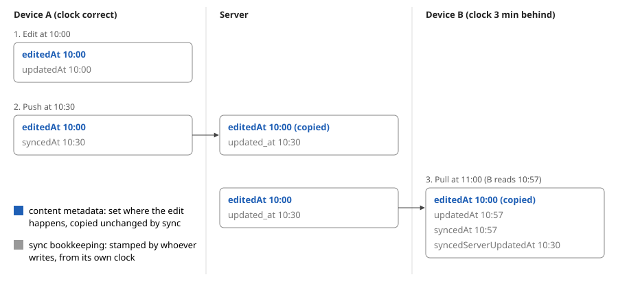

# Data and Sync

Your captions and bookmarks live in the browser first. The server keeps a copy that you push to and pull from by hand, one video at a time. This doc explains what is stored where, how push and pull move a video, and where the copies can drift apart.

## Keep Each Video as a Caption Session

A caption session holds everything about one video: its title and channel, the two caption tracks you picked, the merged caption rows, and your bookmarks. Each bookmark points at a caption row and a position in its text, and it carries the translation, etymology, and notes that you or the LLM filled in.

The caption panel creates a session the first time captions load for a video, and it saves the whole session after every change. Sessions are stored in IndexedDB, one record per video, keyed by its YouTube ID.

A new session is saved before the panel shows it, so picking two tracks is enough for the video to reopen with them, even with no bookmarks yet. When the panel opens, it reads the saved session and asks YouTube for the video's caption tracks at the same time. The saved session needs nothing from YouTube, so it shows even when YouTube refuses the request, and only a video with nothing saved has to wait for the tracks.

Browser storage belongs to an origin. The extension keeps its sessions on its own origin, where the bookmarks page, the background, and every YouTube tab can reach them ([Extension runtime](extension-runtime.md) explains how a YouTube tab gets there). The web app keeps its sessions on its own origin.

## List Videos From a Small Index

Opening every session just to draw the bookmarks page would be slow, so the same database also keeps a video index, one entry per video. An entry holds a video's title, channel, and bookmark count, the time its content was last edited, and what that time was at its last push or pull.

Saving a session updates its index entry in the same transaction, so the two never disagree. A video gets an entry once it has a bookmark, and keeps it at zero bookmarks so that deleting the last one can still be pushed. Until then, its session is stored but the video isn't listed anywhere. A pull adds the entry even with no bookmarks, so the pulled video shows up in the list. So does a push from the caption panel, which first gives the video a video index entry, so captions can reach the server before any bookmarks are picked, such as right after fixing them. Each entry is its own record, so two pages that change different videos at once never overwrite each other.

## Give Each Video an Edit Time That Travels With It

Each video carries the time its content was last edited. The side that makes an edit sets it from its own clock: the browser for edits in the app, the server for edits made through its API. Push and pull copy it unchanged, like the captions and bookmarks, so every copy of a video has the same edit time.

The bookmarks page lists the most recently edited videos first, by the later of the local and server edit times, and shows that time on each card. A video edited elsewhere moves up as soon as the list sees the server's newer time, before it is pulled. Syncing never changes the edit time, so it never moves a card, and every device lists the videos in the same order. Sorting compares times from different clocks, so devices whose clocks disagree can swap two videos edited within that difference. Only the order of those two cards changes.

## Decide the Sync Direction by Comparing Edit Times

Each push or pull also records the edit time it synced. The sync status asks two questions, and each checks whether an edit time still equals the recorded one:

- **Did the local session change?** Its edit time differs from the synced one.
- **Did the server's copy change?** The server's edit time differs from the synced one.

Every edit sets a new edit time, and sync copies edit times exactly, so a difference always means an edit. Nothing checks which time is later, so clocks that disagree can't change the answer. The server stamps its edits to the millisecond, so two server edits in the same second still differ.

The answers decide the status:

- If neither side changed since the last sync, the video is synced.
- If only the local session changed, it needs a push. If only the server changed, it needs a pull.
- If both changed, it's a conflict, and you pick which copy to keep.
- A video that was never synced needs a push if the server doesn't have it, and it's a conflict if the server does.
- A video that exists only on the server needs a pull.
- A video that was synced and then removed from the server needs a push.

## Push and Pull Whole Videos

Push and pull always move a whole video, and the receiving side replaces its copy. A push sends the session to the server, which replaces that video's captions and bookmarks. A pull fetches the server's copy and replaces the local session. Either one then records the synced edit time in the index.

The bookmarks page pushes and pulls directly, in both the extension and the web app. The caption panel does too in the web app. In the extension, the panel asks the background, which holds the session token. A pull from the panel only fetches the session, and the panel applies it itself. The web app's caption panel only shows sessions that are already stored, because it can't fetch subtitles.

In both clients, a pull from the caption panel replaces the captions and bookmarks it shows, so you see the pulled copy without a reload. A conflict in the panel opens the bookmarks page, where you pick which copy to keep.

The caption panel shows the sync status in its header. A local edit updates it at once from the stored edit times. The panel asks the server when it opens, when its tab regains focus more than a minute after the last check, after a push or pull, and when you click Synced. It never polls, because each check is a database read. So the status can miss a server edit made while the tab stays focused, and a push from the panel checks the server again first. If the server changed, the push stops and the status turns into a conflict instead of replacing the other device's edits.

Data can also enter the web app from an `import.json` file, through Import in the header menu. Import writes a session to the web app's storage, and a push then uploads it. [Generate import.json](../skills/zamak/references/generate-import-json.md) describes how to build one without the extension.

## Know Where an Open Page Can Fall Behind

Each page keeps what it shows of the video index in memory and updates it after its own writes. Writes from other pages show up after a reload. So a second YouTube tab keeps the sync status it loaded, and an open bookmarks page doesn't show what a YouTube tab saves, such as a pull.

The caption panel also holds its session in memory while you work, and reads the stored copy only when it opens. If another page saves that video's session while the panel is open, such as a pull from the bookmarks page or an edit in another tab, the panel keeps showing its older copy, and its next edit saves that copy over the newer one.
